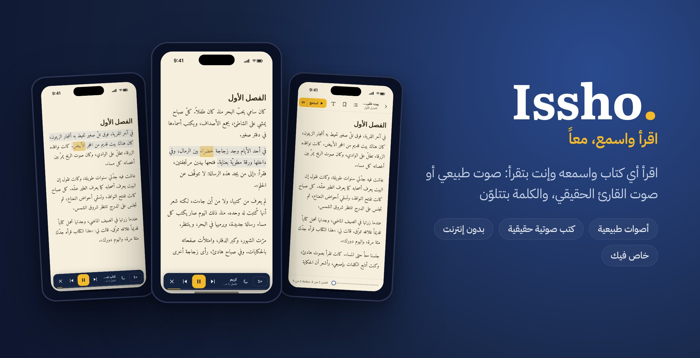
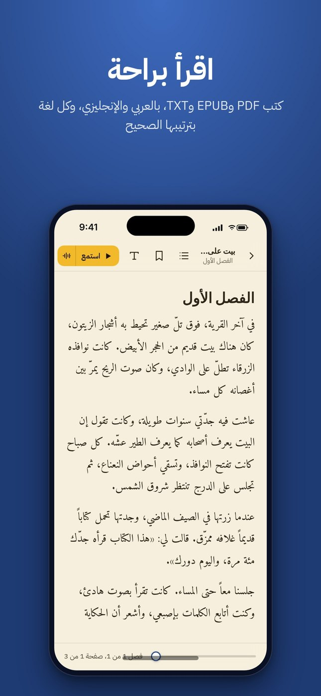
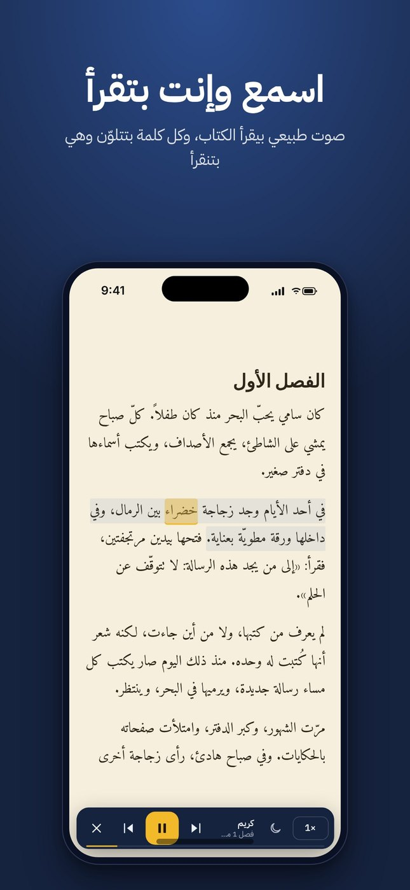
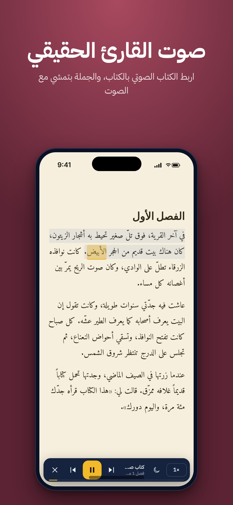
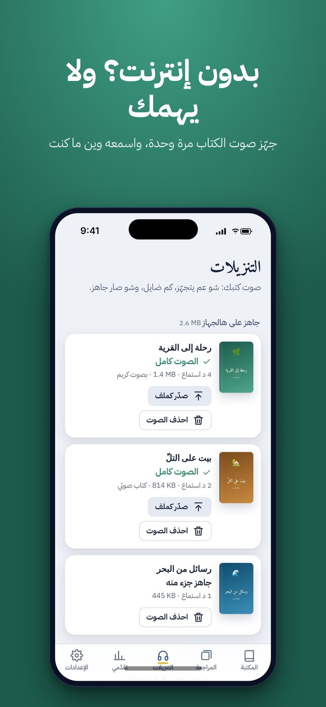

<h3 align="center">اقرأ أي كتاب، واسمعه وإنت بتقرأ.</h3>

<b>Issho</b> (一緒) يعني «معاً» بالياباني: <b>اقرأ واسمع، معاً.</b>

صوت طبيعي أو صوت القارئ الحقيقي، وكل كلمة بتتلوّن وهي بتنقرأ. 
عربي وإنجليزي · من المتصفح · بيتثبّت زي التطبيق · بدون إنترنت · بدون حساب.

<a href="https://getissho.netlify.app"><b>👉 افتح Issho</b></a> · <a href="README.md">English</a> · <a href="docs/video/issho-tour-ar.mp4">▶ جولة بدقيقة (بالصوت)</a>

<table>
  <tr>
    <td width="25%"></td>
    <td width="25%"></td>
    <td width="25%"></td>
    <td width="25%"></td>
  </tr>
</table>

## ليش Issho

الكتاب بيخلص أسرع لما تسمعه. Issho بيجمع النص والصوت: إنت بتقرأ، وهو بيقرأ معك، وعينك ما بتضيّع السطر.

- **كل كلمة بتتلوّن وهي بتنقرأ،** والصفحة بتمشي مع الصوت وبتتقلّب لحالها.
- **صوت طبيعي على جهازك نفسه:** مجاني، وبلا حدود، وبدون إنترنت، وما بيطلع إشي لأي سيرفر.
- **صوت القارئ الحقيقي:** اربط الكتاب الصوتي بالكتاب، والجملة بتمشي مع التسجيل.
- **إلك لحالك:** بدون حساب وبدون سيرفر، كتبك وصوتها وملاحظاتك على جهازك.

<a href="video/issho-audiobook-howto-en.mp4"><b>▶ فيديو قصير: كيف تجهّز الكتاب الصوتي</b></a> (بالإنجليزي): من ملف MP3 لحد ما تسمعه مع صوت القارئ.

## المميزات

| | |
|---|---|
| **قراءة PDF وEPUB وTXT** | صفحات PDF بدقة عالية، وعرض «نص فقط» يعيد ترتيب النص بخط واضح تقدر تكبّره |
| **تقليب زي الكتاب** | اسحب يمين ويسار، والصفحة بتلحق إصبعك |
| **زوم سلس** | قرصة بإصبعين، ضغطتين للتكبير، وتحريك بإصبع وحدة مع انزلاق طبيعي |
| **صوت طبيعي** | صوت مولّد بالذكاء الاصطناعي يشتغل على جهازك مجاناً وبلا حدود، أو أصوات الجهاز، أو Google بمفتاحك. صوت الكتاب بيتنزّل مرة وحدة وبيشتغل بدون إنترنت |
| **الاستماع بدون إنترنت** | نزّل صوت الكتاب مرة وحدة بالصوت الذكي، وبعدها اسمعه كامل بدون نت وبدون توقف، زي تنزيل سورة بتطبيق المصحف. وبتقدر تجهّزه على الكمبيوتر وتنقله للموبايل بملف واحد |
| **تلوين الكلمة أثناء القراءة** | تتابع بعينك الكلمة اللي بتنقرأ، والصفحة بتتقلب لحالها |
| **تظليل وملاحظات** | أربع ألوان، وملاحظة على كل تظليل، وقائمة فيها كلهم |
| **صفحة التنزيلات** | مكان واحد بتشوف فيه صوت أي كتاب عم يتجهّز، النسبة، الوقت الباقي، والجاهز على جهازك، ومنه بتصدّر الكتاب مع صوته للموبايل |
| **مؤقت نوم** | الصوت بيوقف بعد 15 أو 30 أو 45 أو 60 دقيقة استماع، أو آخر الفصل |
| **تحكم بالضغط** | قلّب الصفحة بالضغط على طرف الشاشة، أو بالسحب |
| **صوت عربي ذكي** | الكتب العربية بتنقرأ بصوت طبيعي (Supertonic 3) بيشتغل على جهازك مجاناً وبلا حدود، فيه 10 أصوات رجال ونساء. بيتنزّل مرة وحدة (حوالي 145 ميغا) وبيشتغل بدون إنترنت، وصوت الكتاب بيتجهّز وبينتقل للموبايل متل الإنجليزي |
| **كتاب صوتي بصوت قارئ حقيقي** | اربط الكتاب الصوتي بالكتاب نفسه: بتسمع صوت القارئ، والجملة بتتلوّن وهو بيقرأ، وبتبلّش من أي صفحة. بيقبل ملفات Storyteller (EPUB فيه الصوت)، أو ملف ربط بيتجهّز على GPU مجاني بملف Colab المرفق (`tools/issho-narration-colab-ar.ipynb` بالعربي، `tools/issho-narration-colab.ipynb` بالإنجليزي): مجلد `Issho` على Drive، وجوّاه مجلد لكل كتاب، وكل الكتب بتتجهّز بكبسة وحدة. الكتاب الطويل بيتقسّم لأجزاء، وإذا وقف بيكمّل من مكانه، وبتقدر تسمع قبل ما يخلص |
| **حوّل PDF ↔ EPUB** | على الموبايل، من زر العرض (T) جوّا الكتاب: الـPDF بيصير EPUB نصّه بيترتّب على قد الشاشة، والـEPUB بيصير PDF بصفحات مرتّبة للطباعة أو المشاركة. الأصل بيضل بمكتبتك |
| **واجهة بالعربي أو بالإنجليزي** | التطبيق بيبلّش بالإنجليزي؛ للعربي: Settings ← App language ← العربية. وفيه دليل جوّا التطبيق وشرائح ترحيب للجداد |
| **إحصائيات وأهداف** | دقائق القراءة، هدف يومي، أيام متتالية، ووقتك مع كل كتاب |
| **يشتغل بدون إنترنت** | بعد أول فتح، التطبيق والكتب والصوت الذكي كلهم على جهازك |

## التثبيت كتطبيق

- **الآيفون:** افتح الرابط من Safari، اضغط زر المشاركة، ثم **إضافة إلى الشاشة الرئيسية**.
- **الكمبيوتر (Chrome أو Edge):** اضغط أيقونة التثبيت بشريط العنوان. بعدها بتقدر تفتح ملفات PDF وEPUB مباشرة بـ Issho من قائمة «فتح باستخدام».

## الأصوات

| المصدر | السعر | الجودة | ملاحظات |
|---|---|---|---|
| **الصوت الذكي (Kokoro)** | مجاني بلا حدود | عالية | يتنزّل مرة وحدة (حوالي 90 ميغا) ويشتغل على جهازك بدون إنترنت |
| **الصوت العربي الذكي (Supertonic 3)** | مجاني بلا حدود | عالية، فصحى | للكتب العربية. يتنزّل مرة وحدة (حوالي 145 ميغا) ويشتغل على جهازك بدون إنترنت. فيه «فحص الصوت العربي» بالإعدادات |
| **أصوات الجهاز** | مجاني | حسب الجهاز | على الآيفون نزّل صوت Ava (Premium) من الإعدادات، وعلى ويندوز استخدم متصفح Edge |
| **Google Cloud (Chirp 3 HD)** | مليون حرف مجاناً شهرياً | عالية جداً، وفيها عربي | يحتاج تفعيل الفوترة. Issho بيوقف لحاله عند 900 ألف حرف بالشهر |

المفتاح بينحفظ على جهازك فقط وبتنبعث مباشرة للخدمة. لا تشارك مفاتيحك مع أي حدا.

**وقت تجهيز صوت الكتاب:** الصوت الذكي بيصنع الصوت على جهازك، فوقت التجهيز بيعتمد على سرعة الجهاز مش على الإنترنت. على الكمبيوتر بيشتغلوا كم نسخة من الصوت الذكي مع بعض (حسب أنوية المعالج)، فالتجهيز أسرع بكتير من الموبايل. صفحة «التنزيلات» بتبيّن السرعة والوقت الباقي، وفيها خيار قوة التجهيز وتجربة كرت الشاشة.

**الطريقة الأريح للموبايل:** جهّز صوت الكتاب على الكمبيوتر، اضغط «صدّر للموبايل» بصفحة «التنزيلات»، ابعت الملف لموبايلك وافتحه من «أضف كتاب». الصوت بيشتغل فوراً من أي صفحة، والموبايل ما بيحتاج ينزّل الصوت الذكي ولا يجهّز شي.

**إذا الصوت الذكي ما اشتغل:** الإعدادات ← «فحص الصوت الذكي». بيجرّب كل خطوة لحالها، بيقلك وين بيعلق، وبيعطيك تقرير تنسخه.

## الخصوصية

ما في حساب ولا سيرفر. الكتب والكلمات والتظليلات والإحصائيات محفوظة في متصفحك على جهازك. لما تترجم كلمة، بتنبعث لـ [MyMemory](https://mymemory.translated.net) (أو لـ Google Cloud Translation بمفتاحك إذا فعّلتها)، وللقاموس المجاني [Free Dictionary API](https://dictionaryapi.dev) لمعناها الإنجليزي (من Wiktionary، رخصة CC BY-SA). الترجمة بالضغط على كلمة مطفية لحد ما تفعّلها. سياسة الخصوصية وشروط الاستخدام كاملة جوّا التطبيق: الإعدادات ← الخصوصية / شروط الاستخدام. احفظ نسخة احتياطية من الإعدادات بين فترة وفترة. النسخة بتشتغل على أي جهاز: الكتب بتنعرف من اسم الملف وحجمه، وإذا الكتاب لسا مش على الجهاز الجديد، مكانك وتظليلاتك بيرجعوا أول ما تضيفه.

## المكتبات المستخدمة

- [PDF.js](https://github.com/mozilla/pdf.js) من Mozilla، رخصة Apache 2.0
- [Kokoro-82M](https://huggingface.co/hexgrad/Kokoro-82M) و[kokoro-js](https://github.com/hexgrad/kokoro)، رخصة Apache 2.0
- [misaki](https://github.com/hexgrad/misaki): قوائم نطق الكلمات الإنجليزية اللي تدرّب عليها Kokoro (ملفات `data/`)، رخصة Apache 2.0
- [onnxruntime-web](https://github.com/microsoft/onnxruntime) 1.20.1، رخصة MIT
- قواعد نطق الكلمات غير المعروفة من [HeadTTS](https://github.com/met4citizen/HeadTTS)، رخصة MIT
- [JSZip](https://stuk.github.io/jszip/)، رخصة MIT
- [Supertonic 3](https://github.com/supertone-inc/supertonic) من Supertone: النموذج برخصة OpenRAIL-M، والكود MIT. النسخة المضغوطة (int8) من تحويل sherpa-onnx، منشورة على npm
- [Storyteller](https://gitlab.com/storyteller-platform/storyteller) (رخصة MIT): Issho بيفتح ملفات EPUB اللي بيطلّعها (EPUB 3 Media Overlays). ما في كود منه جوّا Issho
- [faster-whisper](https://github.com/SYSTRAN/faster-whisper) (رخصة MIT): بيشتغل جوّا ملف Colab بس، مش جوّا التطبيق
- [pdf-lib](https://pdf-lib.js.org) و[@pdf-lib/fontkit](https://github.com/Hopding/fontkit)، رخصة MIT (تحويل EPUB إلى PDF)
- خطوط ملفات الـPDF المحوّلة: Literata وAmiri (من حزم @expo-google-fonts)، رخصة OFL
- الخطوط: Literata وAmiri وIBM Plex Sans Arabic من Google Fonts، رخصة OFL

## الرخصة

© 2026 Ibrahem Khrais. كل الحقوق محفوظة: شوف `LICENSE`. المكتبات والنماذج والخطوط المفتوحة المصدر اللي
بيستخدمها Issho إلها رخصها الخاصة: شوف `THIRD_PARTY_NOTICES.md`.

> هالمستودع لعرض المشروع. الكود المصدري خاص.

