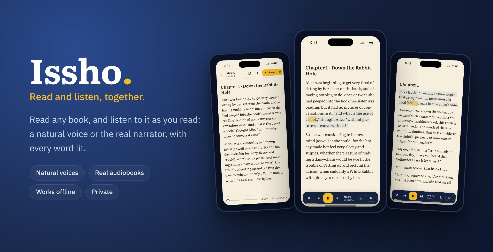
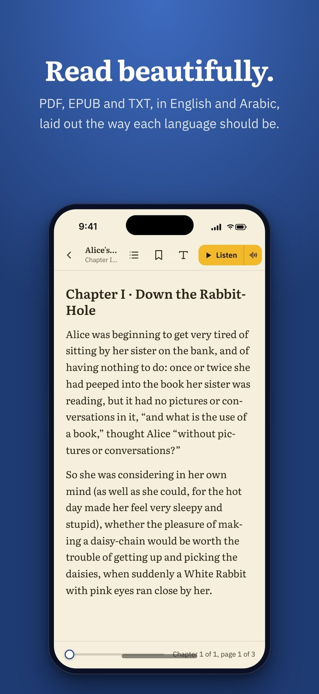
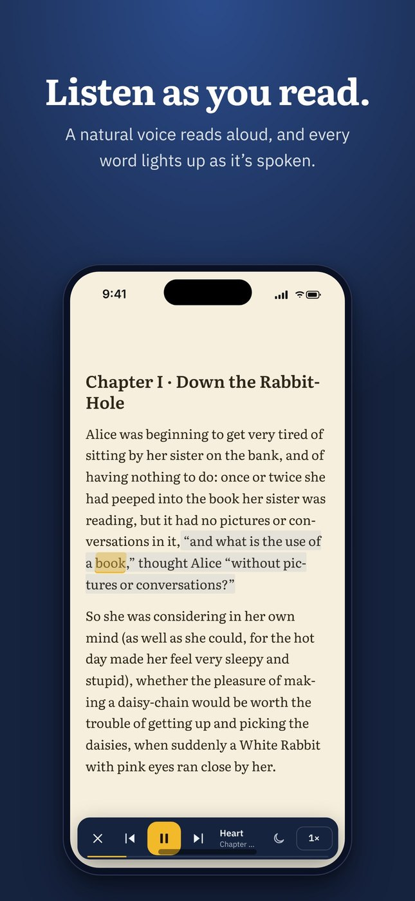
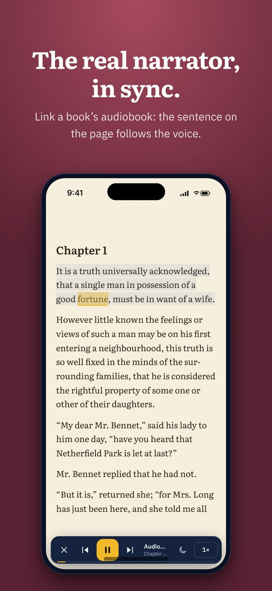
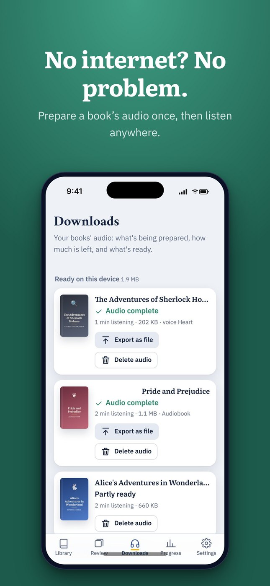
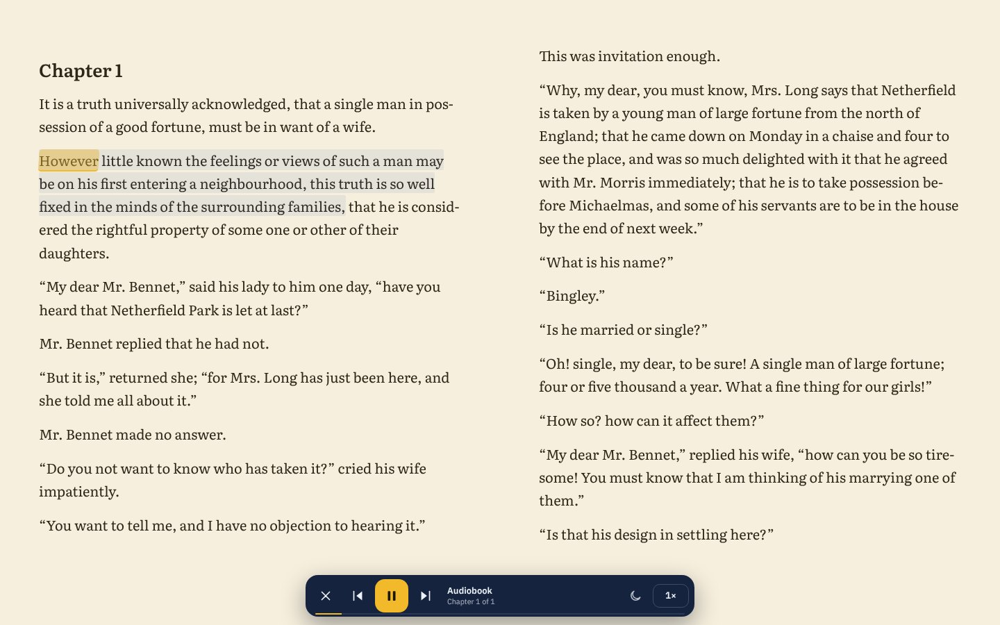

<h3 align="center">Read any book, and listen to it as you read.</h3>

<i>Issho</i> (一緒) is Japanese for <i>together</i>: <b>Read and listen, together.</b>

  A natural voice or the real narrator, with every word lit as it’s read. 
  English and Arabic · in your browser · installs like an app · works offline · no account.

  
  
  
  

<a href="https://getissho.netlify.app"><b>👉 Open Issho</b></a> · <a href="README.ar.md">العربية</a> · <a href="docs/video/issho-tour-en.mp4">▶ 1-minute tour (with sound)</a>

<table>
  <tr>
    <td width="25%"></td>
    <td width="25%"></td>
    <td width="25%"></td>
    <td width="25%"></td>
  </tr>
</table>

## Why Issho

A book is easier to finish when you can hear it. Issho puts the text and the voice together: you read, it reads with
you, and your eyes never lose the line.

- **Every word lit as it’s read.** The page follows the voice and turns by itself.
- **A natural voice on your own device.** Free, unlimited, offline, nothing sent to a server.
- **The real narrator, in sync.** Link a book’s audiobook and each sentence follows the recording.
- **Yours alone.** No account, no server: your books, audio and notes stay on your device.

## What it does

**📖 Read**

- PDF, EPUB and TXT, in English and Arabic, each laid out the right way (right-to-left, Arabic fonts, justified text).
- Pages that turn like a book, your font, background and spacing, highlights with notes, bookmarks.
- A PDF as pages, or as text that reflows to fit your phone; PDF ↔ EPUB conversion on the device.

**🎧 Listen**

- Press Listen: a natural voice reads from the page you’re on, every word lights up, the pages turn by themselves.
- AI voices made on your device: an English voice and ten Arabic voices. Speed from 0.75× to 2×, a sleep timer.
- Prepare a book’s audio once and listen anywhere with no internet; prepare it on a computer and move it to the phone
  as one file.

**🎙️ Real audiobooks**

- The book’s own narrator, synced sentence by sentence to the text, from any page.
- A free Google Colab notebook does the syncing on a GPU: a 15-hour audiobook in under half an hour, every book in a
  Drive folder in one run, and it carries on if it stops.
- Start listening before it’s finished: link the file, and link it again later for the new parts.

**🔒 Private by design**

- Everything is stored in your browser on your device; there is nothing to sign up for.
- English or Arabic interface; a built-in guide and a short welcome for new readers.

## A real audiobook in four steps

| | |
|:-:|---|
| 📁 | In **Google Drive**, make a folder named **Issho**, and inside it a folder for each book with its audio. |
| 📓 | Open the **Colab notebook** (Issho → Downloads → «Download the Colab file», or «Open in Colab»). |
| ▶️ | **Runtime → Run all.** Every book is done, one after another; if it stops, Run all again and it carries on. |
| 🎧 | In Issho: open the book → voice button → **Link an audiobook** → pick the `.narration.zip` from the book’s folder. |

 The same app on a computer: two columns, the narrator’s sentence lit.

## Install as an app

- **iPhone:** open the link in Safari → Share → **Add to Home Screen**.
- **Computer (Chrome or Edge):** the install icon in the address bar. PDF and EPUB files can then be opened with Issho.

## Voices

| Source | Price | Quality | Notes |
|---|---|---|---|
| **Smart voice (Kokoro)** | Free, unlimited | High | Downloaded once (about 90 MB), runs on your device offline |
| **Arabic smart voice (Supertonic 3)** | Free, unlimited | High, Modern Standard Arabic | For Arabic books. Downloaded once (about 145 MB). Settings has an «Arabic voice check» |
| **Device voices** | Free | Depends on the device | On iPhone download Ava (Premium) in Settings; on Windows use Edge |
| **Google Cloud (Chirp 3 HD)** | 1 million characters free a month | Very high, Arabic too | Needs billing enabled. Issho stops by itself at 900k characters a month |

Your key is stored only on your device and sent straight to the service.

## Privacy

There's no account and no server. Books, words, highlights and stats are kept in your browser on your device. When you
translate a word, it is sent to [MyMemory](https://mymemory.translated.net) (or to Google Cloud Translation with your
own key, if you turn that on), and to the [Free Dictionary API](https://dictionaryapi.dev) for its English meaning
(Wiktionary, CC BY-SA). Tap-to-translate is off until you turn it on. The full privacy policy and terms of use are in
the app: Settings → Privacy / Terms of use. Save a backup from Settings now and then; it works on any device (books are
recognised by file name and size).

## Libraries (details and licenses in `THIRD_PARTY_NOTICES.md`)

- [PDF.js](https://github.com/mozilla/pdf.js) (Apache 2.0)
- [Kokoro-82M](https://huggingface.co/hexgrad/Kokoro-82M) and [kokoro-js](https://github.com/hexgrad/kokoro) (Apache 2.0)
- [misaki](https://github.com/hexgrad/misaki) word lists (`data/`, Apache 2.0)
- [onnxruntime-web](https://github.com/microsoft/onnxruntime) 1.20.1 (MIT)
- Letter-to-sound rules from [HeadTTS](https://github.com/met4citizen/HeadTTS) (MIT)
- [JSZip](https://stuk.github.io/jszip/) (MIT)
- [Supertonic 3](https://github.com/supertone-inc/supertonic) by Supertone: model OpenRAIL-M, code MIT; int8 build by sherpa-onnx, published on npm
- [Storyteller](https://gitlab.com/storyteller-platform/storyteller) (MIT): Issho opens the EPUBs it makes (EPUB 3 Media Overlays); no code from it is inside Issho
- [faster-whisper](https://github.com/SYSTRAN/faster-whisper) (MIT): runs only in the Colab notebook, not in the app
- [pdf-lib](https://pdf-lib.js.org) and [@pdf-lib/fontkit](https://github.com/Hopding/fontkit) (MIT)
- Fonts: Literata, Amiri, IBM Plex Sans Arabic (OFL)

## License

© 2026 Ibrahem Khrais. All rights reserved: see `LICENSE`. The open-source libraries, models and fonts
Issho uses keep their own licenses: see `THIRD_PARTY_NOTICES.md`.

> This repository shows the project. The source code is private.
